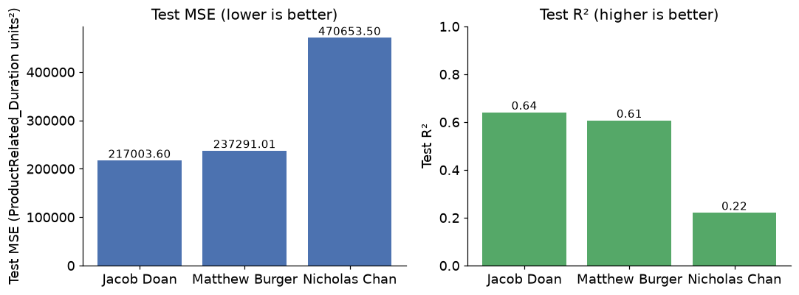
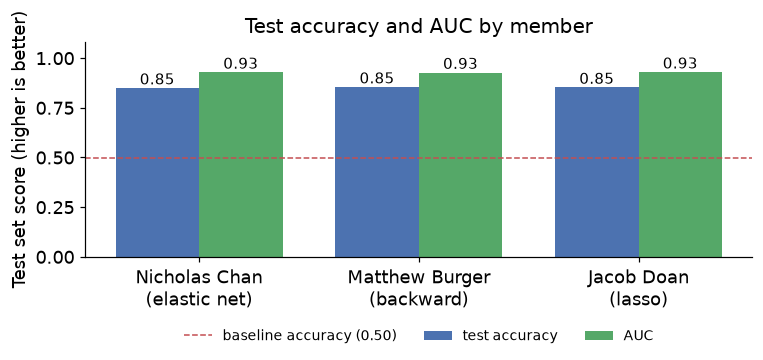

# online-purchase-behavior

## Quick Start

### Activate the virtual environment

**macOS / Linux:**
```bash
source .venv/bin/activate
```
**Windows:**
```bash
.venv\Scripts\activate
```

## Dataset

Online Shoppers Purchasing Intention Dataset

Source: https://archive.ics.uci.edu/dataset/468/online+shoppers+purchasing+intention+dataset

## Checkpoint 1



### Models

**Jacob**

    Predicted ProductRelated_Duration = -9.42 + 45.2·VisitorType[Other] + 59.9·VisitorType[Returning_Visitor] + 40.2·ProductRelated − 0.154·ProductRelated^2 − 569·BounceRates

**Matthew**

    Predicted ProductRelated_Duration = 263 + 112·Revenue[True] + 25·ProductRelated + -1.4e+03·ExitRates

**Nicholas**

    Predicted ProductRelated_Duration = 866 − 21·Weekend[True] + 121·Informational + 48·Administrative − 4.87e+03·ExitRates

## Checkpoint 1



### Models

**Jacob**

    log(p / (1 − p)) = -3.47 + 0.173·ProductRelated + 1.4·Browser_3 + … where p = P(EngagedUser = 1)

**Matthew**

    log(p / (1 − p)) = -3.13 + 0.174·ProductRelated + 0.491·Month_Nov + … where p = P(EngagedUser = 1)

**Nicholas**

    log(p / (1 − p)) = -3.47 + 0.173·ProductRelated + 1.46·Browser_3 + … where p = P(EngagedUser = 1)

